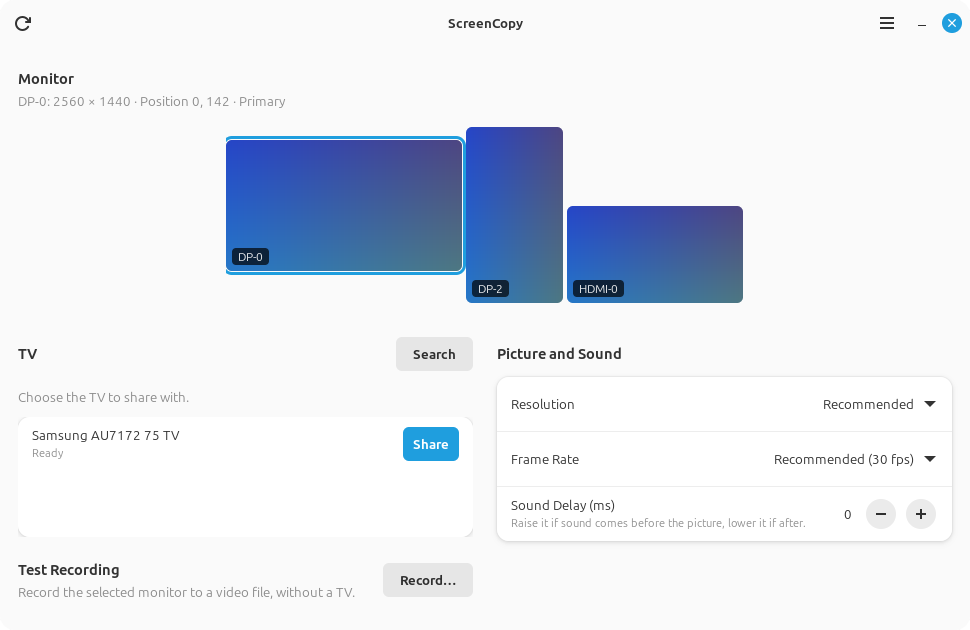

# ScreenCopy

**Show one of your monitors on your TV, wirelessly, from Linux.**

Windows and Apple computers can mirror a screen to a TV with a couple of clicks. On Linux this is
still hard. ScreenCopy is a small desktop program that does it over Miracast (Wi-Fi Display), which
many smart TVs already support, without cables or extra hardware on the TV.

*The monitor pictures here are placeholders. In the program they show your screens.*

## What it solves

- **Share just one monitor.** With several monitors, you choose which one the TV shows. The others
  stay private.
- **Keep your firewall on.** On the test computer, the existing Linux tool, GNOME Network Displays,
  connected only with ufw turned off, and it showed all three monitors. ScreenCopy opens only what
  the TV needs, only on the direct connection to the TV, and only during the session.
- **Sound goes to the TV too,** and returns to your speakers or headphones when you stop.
- **Nothing to set up on the TV side.** Turn on Screen Mirroring on the TV, click Search, click Share.

## Tested on

> **ScreenCopy has been tested only on the setup below.** It may work elsewhere, but nobody has
> checked yet. Reports from other systems and TVs are very welcome.

| | |
|---|---|
| Operating system | Linux Mint 22 (based on Ubuntu 24.04) |
| Desktop | Cinnamon on X11 |
| Graphics | NVIDIA, with three monitors |
| TV | Samsung AU7172 (75") |

## Status and limitations

Early development. Picture and sound work on the setup above.

- **X11 only.** Wayland sessions are not supported.
- **Mirrors an existing monitor.** It cannot create a virtual extra screen for the TV.
- **The Wi-Fi card must support Wi-Fi Direct (P2P),** which you can check with `iw list`.
  NetworkManager must manage the card.
- **If the program crashes while sharing,** the computer has no sound until you start ScreenCopy
  again, which restores the settings.
- **Not yet confirmed:** recovery after a crash, and the test recording from the window.

## Install

There are no ready-made downloads yet, so you build the package yourself. On Linux Mint 22 or
Ubuntu 24.04, install [Rust](https://rustup.rs) (stable) and the build requirements:

    sudo apt install build-essential libgtk-4-dev libadwaita-1-dev \
        libgstreamer1.0-dev libgstreamer-plugins-base1.0-dev \
        gstreamer1.0-plugins-base gstreamer1.0-plugins-good gstreamer1.0-plugins-bad \
        gstreamer1.0-plugins-ugly gstreamer1.0-libav

Then build and install the package. Building needs no root privileges:

    packaging/build-deb.sh
    sudo apt install ./target/debian/screencopy_*.deb

ScreenCopy now appears in the applications menu. To remove it: `sudo apt remove screencopy`.

## Settings

- **Resolution and Frame Rate:** Recommended is best for most uses. The TV reports what it supports
  only while connecting, so if it lacks your choice, ScreenCopy uses the closest format and tells you.
- **Appearance** (in the menu, under Preferences): follow the system, or always light or dark.
- **Keep Running in the Tray** (also under Preferences): closing the window leaves ScreenCopy in the tray, if the desktop has
  one. Quit from the tray's menu or the window's menu. You can turn this off.

## How to use it

1. Turn on Screen Mirroring on the TV.
2. Start ScreenCopy and choose a monitor.
3. Click **Search**, then **Share** next to your TV. Enter your password when asked, and accept the
   request on the TV if it asks.
4. A bar at the top of the window shows that sharing is active. Click **Stop** to end it.

**Only TVs that are waiting for Miracast appear,** so turn on Screen Mirroring first. The cast list in
Chrome can show more devices because Google Cast is a different protocol: it finds devices through your
home network, while Miracast finds them directly over Wi-Fi Direct. ScreenCopy works with Miracast only.
If several TVs are found, the list scrolls and the window says how many there are.

If the sound and the picture do not match, adjust **Sound Delay** while watching. Raise it if the
sound comes first, lower it if the picture does. The value is saved for next time. It can delay the
sound by up to 500 ms, but the picture by only 100 ms, to keep the stream valid for the TV.

## Privacy and security

- **No telemetry, and no network connections** other than the one to your TV.
- **The screen is shared only after you click Share,** and a Stop button stays available for the
  whole session, in the window and in the tray, whose icon changes while sharing.
- **Monitor pictures** in the window are taken once when it opens and when you click Refresh, so that
  you can recognize each monitor. They stay in memory, and are never saved or sent anywhere.
- **The program itself never runs as root.** A small separate helper, started through polkit, allows
  incoming TCP 7236 (RTSP) and UDP 67 (DHCP), only on the Wi-Fi Direct interface. It removes the
  rules when ScreenCopy ends for any reason, including a crash. The rules are not saved, so a reboot
  clears them too. The firewall is never turned off.
- **Everything received from the TV is treated as untrusted:** sizes are limited, and malformed data
  ends the session rather than crashing the program.

## Development

Run from the source tree:

    RUST_LOG=debug cargo run

To rule out an encoder problem, force one with `SCREENCOPY_ENCODER=x264enc` or
`SCREENCOPY_ENCODER=nvcudah264enc`. To compare smoothness, request `SCREENCOPY_FRAME_RATE=60`, which
applies if the TV supports it. To change how often key frames are sent, set
`SCREENCOPY_KEY_FRAME_DISTANCE` to a number of frames. To compare other settings, use
`SCREENCOPY_BITRATE_KBIT` with a bitrate, `SCREENCOPY_PACING_MS` to change how far behind real time packets
are sent evenly (100 by default, 0 turns it off), or `SCREENCOPY_NO_AUDIO=1` to send video only.

Sharing needs the firewall helper. The package installs it. Without the package, install it by hand:

    cargo build --release --bin screencopy-firewall-helper
    sudo install -D -m 755 -o root -g root target/release/screencopy-firewall-helper \
        /usr/libexec/screencopy/screencopy-firewall-helper
    sudo install -m 644 -o root -g root data/io.github.sinkec.ScreenCopy.policy \
        /usr/share/polkit-1/actions/io.github.sinkec.ScreenCopy.policy

With firewalld, also install its zone. This path has not been tested on a real firewalld:

    sudo install -m 644 -o root -g root data/screencopy.firewalld.xml \
        /usr/lib/firewalld/zones/screencopy.xml
    sudo firewall-cmd --reload

Checks:

    cargo fmt --check
    cargo clippy --all-targets -- -D warnings
    cargo test

Dependency checks use two extra tools:

    cargo install --locked cargo-audit cargo-deny
    cargo audit
    cargo deny check

## License

Copyright © 2026 Matej Jazbinšek. Free software under the GNU General Public License, version 3 or
later. It comes with absolutely no warranty. See [LICENSE](LICENSE).

The libraries compiled into the program are under MIT, Apache-2.0 and similar licenses, all compatible
with the GPL. The package includes their full texts in
`/usr/share/doc/screencopy/THIRD-PARTY-LICENSES`. GTK, libadwaita, GStreamer and its plugins, and the
other programs ScreenCopy uses are installed separately, under their own licenses.

ScreenCopy sends H.264 video and AAC audio, using the encoders installed on your system. These formats
may be covered by patents in some countries. It is your responsibility to check this if it applies to
your use.

## Acknowledgements

[GNOME Network Displays](https://gitlab.gnome.org/GNOME/gnome-network-displays) (GPL-3.0-or-later) was
a valuable reference for how real TVs expect a Miracast source to behave.

## Trademarks

Miracast and Wi-Fi Direct are trademarks of the Wi-Fi Alliance. Samsung is a trademark of Samsung
Electronics. ScreenCopy is an independent project, is not certified by the Wi-Fi Alliance, and is not
affiliated with or endorsed by any of these companies. The names are used only to describe what the
program works with.
