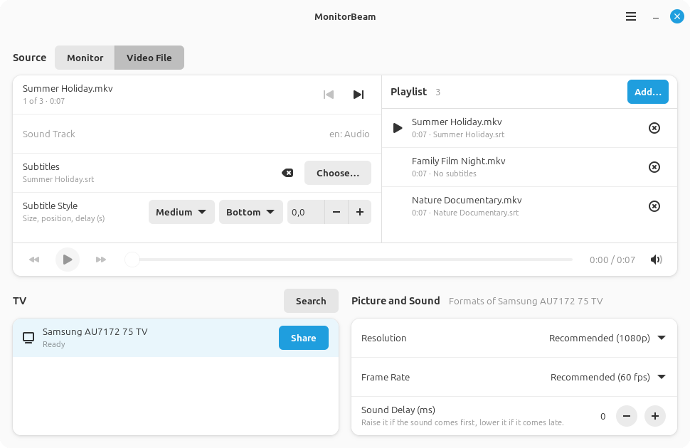

# MonitorBeam

**Wirelessly show one of your Linux monitors, or a video file, on a TV, with sound.**

MonitorBeam mirrors a single monitor, or plays a video file, on a smart TV over Miracast (Wi-Fi Display). Windows and macOS make
screen mirroring a matter of a few clicks. MonitorBeam brings that experience to the Linux desktop, with no
cables and no extra hardware.

*The monitor pictures above are placeholders. In the program, they show your screens. The window also plays video
files, shown [below](#playing-a-video-file).*

## Features

- **One monitor, not the whole desktop.** Pick a monitor from a picture of your real layout, including its size,
  position and rotation. Your other monitors stay private.
- **Video files with subtitles.** Play a film or a whole playlist straight from its files, while you keep using the
  computer. Pause and seek freely, go on later from where you stopped, and add SRT subtitles that you can adjust while
  watching.
- **Your firewall stays on.** MonitorBeam opens only what the TV needs, only on the direct connection to the TV,
  and only during the session.
- **Sound on the TV.** System sound moves to the TV, and returns to your speakers or headphones when you stop.
- **Finds your TV by itself.** Your last used TV waits at the top of the list, and MonitorBeam remembers which
  formats each TV supports.
- **Runs quietly in the tray.** The tray icon shows when sharing is active, and offers Stop.
- **Private by design.** No telemetry, no accounts, and no network connections other than the one to your TV.

## Tested on

> [!IMPORTANT]
> MonitorBeam has been tested only on the setup below. It may work elsewhere, but this has not been checked yet.
> Reports from other systems and TVs are very welcome in the
> [issue tracker](https://github.com/sinkec/MonitorBeam/issues).

| Component | Tested with |
|---|---|
| Operating system | Linux Mint 22 (based on Ubuntu 24.04) |
| Desktop | Cinnamon on X11 |
| Graphics | NVIDIA, with three monitors |
| TV | Samsung AU7172 (75") |

## Requirements

- Linux Mint 22, Ubuntu 24.04, or a similar distribution with GTK 4.14, libadwaita 1.5 and GStreamer 1.24 or newer
- An X11 session (Wayland is not supported)
- A Wi-Fi card with Wi-Fi Direct support, managed by NetworkManager. To check, run `iw list` and look for
  `P2P-client` under the supported interface modes
- A TV or other receiver with Miracast, often called Screen Mirroring

## Installation

Download the `.deb` package from the [latest release](https://github.com/sinkec/MonitorBeam/releases/latest), then
install it from the download folder:

    sudo apt install ./monitorbeam_*_amd64.deb

MonitorBeam then appears in the applications menu. To remove it, run `sudo apt remove monitorbeam`.

To build the package yourself, see [Development](#development).

## Usage

1. Turn on Screen Mirroring on the TV.
2. Start MonitorBeam and choose a monitor. It looks for TVs at once.
3. Click **Share** next to your TV. If a firewall is running, enter your password when asked. Accept the request on
   the TV if it asks.
4. The TV's row shows the state of the session. Click **Stop** there, or in the tray's menu, to end it.

### Settings

| Setting | What it does |
|---|---|
| **Resolution and Frame Rate** | Recommended suits most uses, which is 30 frames per second for a monitor and 60 for a film. A TV reports its formats only while connecting, so after the first connection MonitorBeam offers only what that TV supports. Until then, it uses the closest format to your choice and tells you if it differs. |
| **Sound Delay** | Matches the sound to the picture, and can be changed while watching. Raise it if the sound comes first, lower it if it comes late. It can delay the sound by up to 500 ms, and the picture by up to 100 ms. |
| **Video File Quality** | Films use more data than a shared monitor, for a sharper picture. Choose a lower quality if a film stutters on the TV. In the window's menu, under Preferences. |
| **Appearance** | Follows the system, or stays light or dark. In the window's menu, under Preferences. |
| **Keep Running in the Tray** | Closing the window leaves MonitorBeam in the tray, if the desktop has one. Quit from the tray's menu or the window's menu. In the window's menu, under Preferences. |

### Playing a video file

1. Under **Source**, choose **Video File**, then add one or more files to the playlist, or drop them onto the window.
   They play one after another, without a new connection, and the playlist shows each one's length and subtitles.
   Subtitles with the same name next to a film are used automatically. To choose others, click the film in the
   playlist, then **Choose…** under Subtitles.
2. Click **Share** next to your TV. A film you did not finish goes on from where you stopped, with a way to start over.

| Key | While a film plays |
|---|---|
| Space | Pause or play |
| Left and Right Arrows | Go back or forward by 10 seconds, which the buttons next to Play also do |
| Up and Down Arrows | Change the film's volume |

Pausing also works from the tray's menu. Only the film's sound goes to the TV, and the computer's other sounds stay on
the computer. Subtitles are added to the picture as it is sent, so size, position and delay can change while watching,
even during a pause. The file itself is never changed. Files in Central European encodings such as Windows-1250 are
read automatically.

To try MonitorBeam without a TV, choose **Test Recording…** in the window's menu. It records the chosen monitor to a
video file.

## Troubleshooting

| Problem | What to try |
|---|---|
| The TV is not found | Make sure Screen Mirroring is open on the TV, then click **Search**. A TV can close it when sharing ends. A TV can also need a few minutes before it can be found again after a session, and MonitorBeam keeps looking during that time. |
| A device appears in Chrome's cast list, but not here | Google Cast is a different protocol, which finds devices through your home network. MonitorBeam supports Miracast only, which needs a TV that is waiting over Wi-Fi Direct. |
| The TV does not connect | If you use a firewall other than ufw or firewalld, MonitorBeam cannot see it. After 12 seconds, it asks to open the firewall. |
| The picture stutters | Choose 720p or 30 fps, lower the **Video File Quality**, or move the computer closer to the TV. |
| The connection is lost during sharing | MonitorBeam connects again up to three times, and a film goes on from the same place. Make sure Screen Mirroring is still open on the TV. |
| The sound does not match the picture | Adjust **Sound Delay** while watching. First check that the video is in sync on the computer. |
| No sound on the computer after a crash | Start MonitorBeam again. It restores the sound settings. |

To report a problem, include the output of `RUST_LOG=debug monitorbeam`, and the versions from
**About MonitorBeam → Troubleshooting** in the window's menu.

## Privacy and security

- **Capture needs your action.** The screen is shared or recorded only after you click **Share** or start a recording,
  and Stop stays available the whole time. The window's title and the tray icon show that it is active.
- **Monitor pictures** in the window are taken once when it opens and when you click Refresh. They stay in memory, and
  are never saved or sent anywhere.
- **Video files** are read only on this computer, and go only to the TV. Decoding a file from the internet relies on
  GStreamer, so keep it updated. The program never has more than your own user's rights while doing this.
- **Watch positions:** where you stopped in a film is saved in a private file, `~/.config/monitorbeam/positions`, with
  checksums rather than file names, so that it does not list what you watched.
- **Looking for TVs** starts when the window opens, and lasts 30 seconds. It connects to nothing and captures nothing.
- **Remembered TVs:** the name, hardware address and formats of TVs you have shared with are saved in a private file,
  `~/.config/monitorbeam/tvs`, on this computer only. Delete the file to forget them.
- **The program never runs as root.** The TV has to connect to the computer, so a running firewall must let it in. A
  small separate helper, started through polkit, allows incoming TCP 7236 (RTSP) and UDP 67 (DHCP), only on the Wi-Fi
  Direct interface. You enter your password once while MonitorBeam runs. The helper then waits, and opens these rules
  only for each session with the TV. It removes them when the session or MonitorBeam ends for any reason, including a
  crash, and a reboot clears them too. The firewall is never turned off.
- **No password without a firewall.** If neither ufw nor firewalld is running, MonitorBeam opens nothing and asks for
  nothing.
- **The TV is not trusted.** Everything it sends is limited in size, and malformed data ends the session rather than
  crashing the program.

To report a security problem, please open an
[issue](https://github.com/sinkec/MonitorBeam/issues) without sensitive details, and ask for a private way to share them.

## Limitations

- **X11 only.** Wayland sessions are not supported.
- **Mirrors an existing monitor.** It cannot create a virtual extra screen for the TV.
- **Picture formats** are limited to what the program can send: up to 1920 × 1080, at 30 or 60 frames per second. A
  film at 24 frames per second is converted, which can make slow pans a little uneven. HDR films can look pale.
- **Not yet confirmed:** the firewalld path on a real firewalld, and asking to open the firewall after
  12 seconds has not been seen in practice.

## Development

MonitorBeam is written in Rust, with GTK 4 and libadwaita for the window, GStreamer for video and sound, and
NetworkManager for Wi-Fi Direct. On Linux Mint 22 or Ubuntu 24.04, install [Rust](https://rustup.rs) (stable) and the
build requirements:

    sudo apt install build-essential libgtk-4-dev libadwaita-1-dev \
        libgstreamer1.0-dev libgstreamer-plugins-base1.0-dev \
        gstreamer1.0-plugins-base gstreamer1.0-plugins-good gstreamer1.0-plugins-bad \
        gstreamer1.0-plugins-ugly gstreamer1.0-libav

Run from the source tree:

    RUST_LOG=debug cargo run

Build the package, which needs no root privileges, and install it:

    packaging/build-deb.sh
    sudo apt install ./target/debian/monitorbeam_*.deb

Run the checks before sending changes:

    cargo fmt --check
    cargo clippy --all-targets -- -D warnings
    cargo test

Check the dependencies after changing them:

    cargo install --locked cargo-audit cargo-deny
    cargo audit
    cargo deny check

### Firewall helper

Sharing with a firewall running needs the helper, which the package installs. Without the package, install it by hand:

    cargo build --release --bin monitorbeam-firewall-helper
    sudo install -D -m 755 -o root -g root target/release/monitorbeam-firewall-helper \
        /usr/libexec/monitorbeam/monitorbeam-firewall-helper
    sudo install -m 644 -o root -g root data/io.github.sinkec.MonitorBeam.policy \
        /usr/share/polkit-1/actions/io.github.sinkec.MonitorBeam.policy

With firewalld, also install its zone:

    sudo install -m 644 -o root -g root data/monitorbeam.firewalld.xml \
        /usr/lib/firewalld/zones/monitorbeam.xml
    sudo firewall-cmd --reload

### Options for testing

These environment variables help to compare settings on a particular TV and network:

| Variable | Effect |
|---|---|
| `MONITORBEAM_ENCODER` | Forces an encoder, such as `x264enc` or `nvcudah264enc` |
| `MONITORBEAM_FRAME_RATE` | Requests a frame rate, such as `60`, if the TV supports it |
| `MONITORBEAM_KEY_FRAME_DISTANCE` | Sets how many frames lie between key frames |
| `MONITORBEAM_BITRATE_KBIT` | Sets the video bitrate |
| `MONITORBEAM_PACING_MS` | Sets how far behind real time packets are sent evenly. The default is 100, and 0 turns it off |
| `MONITORBEAM_NO_AUDIO` | Set to `1` to send video only |

## License

Copyright © 2026 Matej Jazbinšek. MonitorBeam is free software under the
[GNU General Public License, version 3 or later](LICENSE). It comes with absolutely no warranty.

The libraries compiled into the program are under MIT, Apache-2.0 and similar licenses, all compatible with the GPL.
The package includes their full texts in `/usr/share/doc/monitorbeam/THIRD-PARTY-LICENSES`. GTK, libadwaita,
GStreamer and its plugins, and the other programs MonitorBeam uses are installed separately, under their own licenses.

MonitorBeam sends H.264 video and AAC audio, using the encoders installed on your system. These formats may be covered
by patents in some countries. It is your responsibility to check this if it applies to your use.

## Acknowledgements

[GNOME Network Displays](https://gitlab.gnome.org/GNOME/gnome-network-displays) (GPL-3.0-or-later) was a valuable
reference for how real TVs expect a Miracast source to behave.

## Trademarks

Miracast and Wi-Fi Direct are trademarks of the Wi-Fi Alliance. Samsung is a trademark of Samsung Electronics. Google
Cast is a trademark of Google LLC. MonitorBeam is an independent project, is not certified by the Wi-Fi Alliance, and
is not affiliated with or endorsed by any of these companies. The names are used only to describe what the program
works with.
